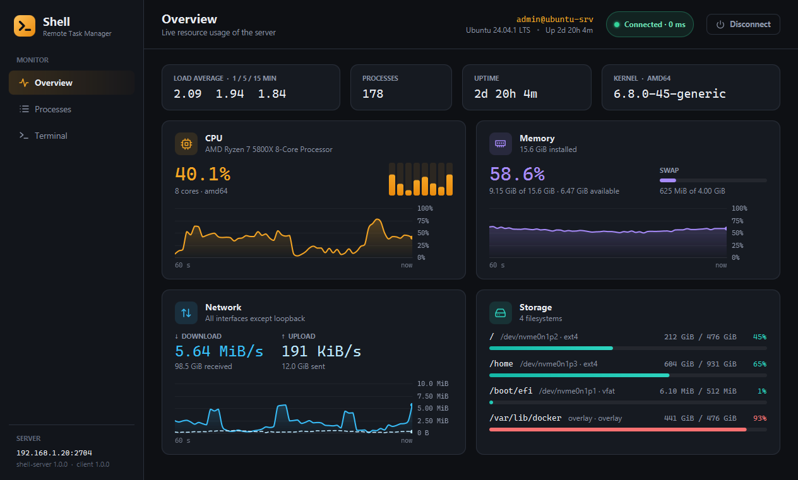
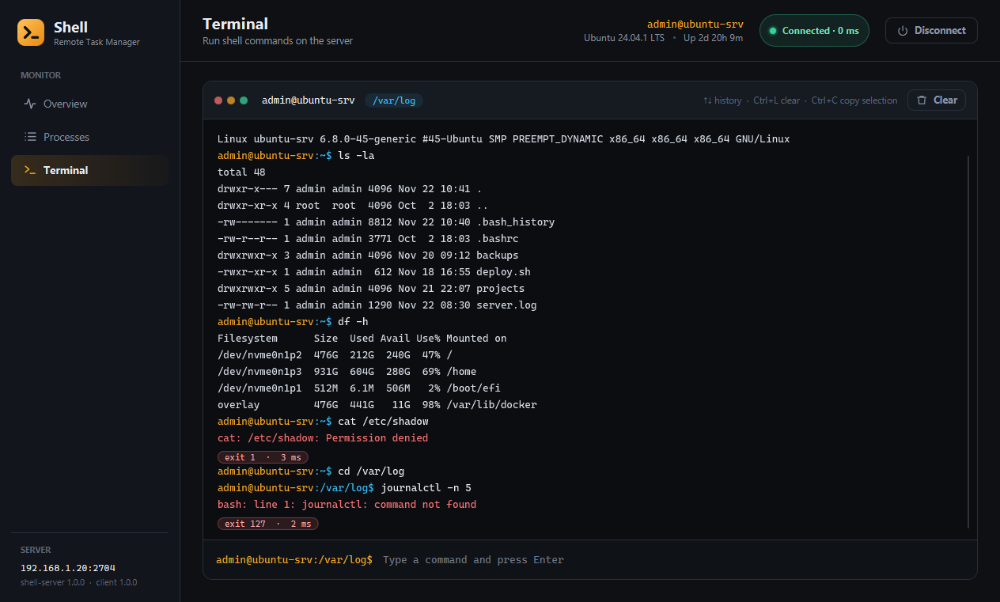

# Shell Linux — Servidor

Servidor en Java que permite administrar un equipo Linux en forma remota desde el cliente de escritorio
[Shell-Windows](https://github.com/NastMz/Shell-Windows): una consola remota con semántica real de `bash`, un
monitor de recursos en vivo (CPU, memoria, discos y red) y un administrador de procesos.

Proyecto del curso de **Sistemas Operativos**: versión final `1.0.0`.



## Características

- **Consola remota**: cada comando se ejecuta con `bash -c`, así que funcionan pipes, redirecciones, comillas,
  comodines y `&&`. El `cd` se conserva entre comandos de la misma sesión. Devuelve stdout, stderr, código de
  salida y duración, con un tiempo límite configurable que termina todo el árbol de procesos.
- **Monitor de recursos**: lee directamente `/proc` (no analiza la salida de `top`). Un muestreador interno
  calcula cada segundo el uso de CPU total y por núcleo, la memoria y el swap, el espacio de cada sistema de
  archivos, la velocidad de red, el load average y el uptime.
- **Administrador de procesos**: lista de procesos con PID, usuario, estado, % de CPU, memoria, hilos y línea
  de comandos. Permite terminarlos con `SIGTERM` o `SIGKILL`; el PID 1 y el propio servidor están protegidos.
- **Multiusuario y concurrente**: atiende varios clientes a la vez y responde las peticiones de cada sesión en
  paralelo, de modo que un comando largo no congela las gráficas.
- **Autenticación**: cuentas en `users.properties` con contraseñas derivadas por PBKDF2-SHA256 con sal, y
  comparación en tiempo constante. Tras 3 intentos fallidos se cierra la conexión.
- **Protocolo documentado**: JSON delimitado por saltos de línea sobre TCP, descrito en
  [`docs/PROTOCOL.md`](docs/PROTOCOL.md).

## Requisitos

- Linux con `bash` y `/proc` (cualquier distribución moderna).
- Java 17 o superior para ejecutar. Maven 3.9+ para compilar.
- O bien Docker.

## Inicio rápido

### Con Docker

```bash
SHELL_PASSWORD='una-contraseña-segura' docker compose up -d --build
```

Crea la cuenta `admin` (configurable con `SHELL_USER`) en el primer arranque y escucha en el puerto `2704`.
Las cuentas se guardan en el volumen `shell-data`. Para administrar más cuentas:

```bash
docker compose run --rm shell-server useradd maria
docker compose run --rm shell-server users
```

> Dentro de un contenedor el servidor ve los procesos y el sistema de archivos del contenedor. Para
> administrar el equipo anfitrión completo, ejecútalo directamente sobre el host.

### Sin Docker

```bash
mvn -B package                                   # genera target/shell-server.jar
java -jar target/shell-server.jar useradd admin  # pide la contraseña dos veces
java -jar target/shell-server.jar                # inicia el servidor en 0.0.0.0:2704
```

Después, abre el cliente de Windows y conéctate con la IP del servidor, el puerto y la cuenta creada.

## Uso de la línea de comandos

```text
java -jar shell-server.jar [serve] [--port PORT] [--bind ADDRESS] [--users FILE]
java -jar shell-server.jar useradd <username> [--password-stdin] [--users FILE]
java -jar shell-server.jar userdel <username> [--users FILE]
java -jar shell-server.jar users [--users FILE]
```

| Opción             | Descripción                                               |
|--------------------|-----------------------------------------------------------|
| `--port PORT`      | Puerto TCP (por defecto `2704`).                          |
| `--bind ADDRESS`   | Dirección en la que escucha (por defecto `0.0.0.0`).      |
| `--users FILE`     | Archivo de cuentas (por defecto `users.properties`).      |
| `--password-stdin` | `useradd` lee la contraseña de la primera línea de stdin. |
| `NO_COLOR=1`       | Variable de entorno que desactiva los colores del log.    |

Los cambios en el archivo de cuentas se aplican sin reiniciar el servidor.

El log de consola registra conexiones, inicios de sesión y cada comando ejecutado:

```text
server@linux~$ 2026-11-22 16:41:41 INFO  Listening on 0.0.0.0:2704
server@linux~$ 2026-11-22 16:42:02 INFO  User 'admin' logged in from 172.17.0.1:40108
server@linux~$ 2026-11-22 16:43:18 INFO  admin@172.17.0.1:40108 [/home/shell] $ cd /var/log
```



## Arquitectura

```text
com.osproject.shell.server
├── cli        Comandos serve / useradd / userdel / users
├── net        ShellServer (accept loop) y ClientSession (una por conexión)
├── protocol   Envoltorio JSON, códec y códigos de error
├── auth       UserStore (users.properties) y PasswordHasher (PBKDF2)
├── metrics    Parsers de /proc y SystemSampler (muestras cada segundo)
├── process    Listado y señales de procesos
├── shell      CommandExecutor (bash -c, cwd persistente, límites y timeout)
└── log        Formato de consola con colores
```

## Pruebas

```bash
mvn -B verify
```

Las pruebas de los parsers de `/proc`, la autenticación y el protocolo corren en cualquier sistema. Las de
ejecución de comandos y señales solo corren en Linux; para ejecutarlas desde Windows:

```bash
docker run --rm -v "$PWD:/src" -w /src maven:3-eclipse-temurin-17 mvn -B verify
```

## Seguridad

Es un proyecto académico. El tráfico **no está cifrado** y los comandos se ejecutan con los permisos del usuario
que inicia el servidor: úsalo solo en redes de confianza, nunca expuesto a Internet, y no lo ejecutes como `root`.

## Licencia

[MIT](LICENSE)
